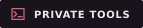

<div align="center">
  
</div>

<p align="center">
  <a href="https://github.com/d3faulth-private"></a>&nbsp;
  <a href="#about"></a>&nbsp;
  <a href="https://github.com/d3faulth-private?tab=repositories"></a>&nbsp;
  <a href="#building-a-team"></a>
</p>


<a id="about"></a>

## 👨‍💻 About

```python
profile = {
    "handle"   : "D3FAULTH",
    "role"     : "Invincible",
    "focus"    : "Shared knowledge · Practical problem-solving",
    "building" : "Private tools · Shared workflows",
    "team_os"  : "Anonymous OS · Members-only access planned",
    "training" : "Hack The Box",
    "team"     : "Bringing hackers together",
}
```

I'm **D3FAULTH** — a hacker bringing other hackers together to share what we know, work through difficult problems, and make tasks easier for each other. We combine our skills, exchange useful information, and build tools that reduce repetitive work.

**Hack The Box** is part of our shared practice. We're building **private tools** and **Anonymous OS** for team members, while sharing selected tools, research, and writeups here.


## 🛠️ Toolkit & Focus

**Core**


**Environment**


**Security Lab**


**Research Interests**


## 🛡️ Team Tools & Anonymous OS




- **Private tools:** shared scripts and utilities that simplify research, automate repetitive steps, and help teammates solve problems together.
- **Anonymous OS:** our custom amnesic security workstation, with privacy and security controls built into its design. Distribution is intended for **team members only**.

**In development.** These are the team's planned capabilities; release readiness and security validation remain work in progress.


<a id="building-a-team"></a>

## 🏴 Building a Team

**Team in formation — shared knowledge, combined skills, easier tasks.**

We're bringing hackers together to exchange ideas, compare methods, share useful information, and help each other get unstuck. Everyone brings something different; working together lets us learn faster and avoid repeating the same work.

We'll practice on Hack The Box, build shared tools, and collaborate on research in systems we own or have permission to test.

**[Interested in joining? Introduce yourself →](https://github.com/d3faulth-private/d3faulth-private/issues/new?title=Team%20interest)**  
Share your handle, interests, and usual availability. Introductions through GitHub Issues are public.


## 📊 GitHub Stats

<p align="center">
  <a href="https://github.com/d3faulth-private">
    
  </a>&nbsp;
  <a href="https://github.com/d3faulth-private">
    
  </a>
</p>
<p align="center">
  <a href="https://github.com/d3faulth-private?tab=repositories">
    
  </a>
</p>


<div align="center">
  
</div>
