<div align="center">
  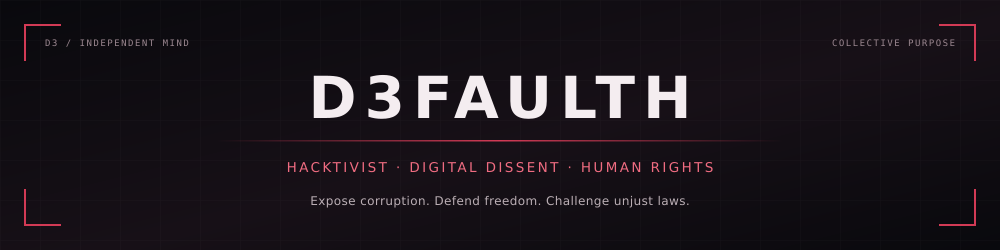
</div>

<p align="center">
  <a href="https://github.com/d3faulth-private"></a>&nbsp;
  <a href="#hack-the-box"></a>&nbsp;
  <a href="#contact">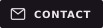</a>&nbsp;
  <a href="threshold/README.md"></a>
</p>


<a id="about"></a>

## About

```python
profile = {
    "handle"   : "D3FAULTH",
    "identity" : "Digital Dissident",
    "mindset"  : "Invincible",
    "focus"    : "Digital dissent · Privacy · Accountability",
    "mission"  : "Human rights · Challenging unjust laws",
    "projects" : "The Collective · Private tools · Anonymous OS",
    "practice" : "Hack The Box",
}
```

I'm **D3FAULTH** — a digital dissident building a collective around human rights, privacy, and accountability. We bring our skills together to investigate abuse, document evidence, expose corruption, and advocate for changes to unjust laws. Our goal is lasting change through technical work and collective action.

**Independent minds. Shared purpose.** We exchange methods, build useful tools, and help each other solve difficult problems. Research, evidence, and the work we publish should speak for themselves.


## Work & Direction

| Project | Purpose | Status |
| :-- | :-- | :-- |
| [Public repositories](https://github.com/d3faulth-private?tab=repositories) | Selected tools and experiments released under D3FAULTH. | Public work |
| **Anonymous OS** | An amnesic security workstation designed around privacy and session isolation. Circulated only within The Collective. | Developed · Invitation only |
| **Private tools** | Shared utilities to simplify research and repetitive work. Access is restricted to accepted members. | Members only |
| [The Threshold](threshold/README.md) | Five practical assessment tracks for prospective members. | Exercises open · Applications pending |

Anonymous OS is developed and distributed privately to members accepted into The Collective by invitation. Access to the private toolkit is reserved for those members.


## Toolkit & Research

**Core**

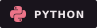
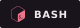


**Environment**

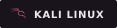
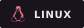


**Security Lab**


**Research Interests**

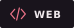
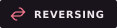
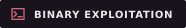
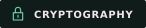
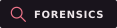

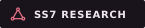

**Current interest:** SS7 vulnerability research and telecom signaling security.


<a id="building-a-team"></a>
<a id="the-collective"></a>

## The Collective

**A team in formation. A shared commitment to freedom, privacy, and accountability.**

We're bringing together hackers, researchers, and builders who can contribute practical expertise and explain their work. We value careful reasoning, constructive collaboration, and respect for the people whose rights we want to protect.

Our technical practice takes place in designated labs and systems we own or have permission to test. Our wider mission is evidence-led advocacy for human rights and legal reform.

### Entry starts at The Threshold

Choose a specialty, complete an original offline task, and prepare a short writeup. **A correct result earns a review; membership follows a review and an invitation.** Private tools and OS access are granted separately after acceptance.

**[Enter The Threshold →](threshold/README.md)** · [How review works](threshold/REVIEW.md)

The exercises are available now. Private applications will open when the contact channel below is published. Keep your solutions private in the meantime.

<a id="hack-the-box"></a>

### Hack The Box

**Handle: D3FAULTH.** Hack The Box is part of our practical training. Members can compare approaches, learn together, and support their applications with permitted writeups of retired content.

[Explore Hack The Box](https://www.hackthebox.com/) · **Team URL pending.**

<a id="contact"></a>

### Contact

**Private contact details are being prepared.** The email address and HTB team link will appear here once available. Public applications are not open yet.

Please keep application writeups and personal contact details out of public GitHub Issues. Preparing an exercise does not require your real name or any account credentials.


## GitHub Activity

<p align="center">
  <a href="https://github.com/d3faulth-private">
    
  </a>&nbsp;
  <a href="https://github.com/d3faulth-private">
    
  </a>
</p>
<p align="center">
  <a href="https://github.com/d3faulth-private?tab=repositories">
    
  </a>
</p>


<div align="center">
  
</div>
