<div align="center">
  
</div>

<p align="center">
  <a href="https://github.com/d3faulth-private"></a>&nbsp;
  <a href="#hack-the-box"></a>&nbsp;
  <a href="#contact"></a>&nbsp;
  <a href="threshold/README.md"></a>
</p>


<a id="about"></a>

## About

```python
profile = {
    "handle"   : "D3FAULTH",
    "identity" : "Digital Dissident",
    "mindset"  : "Invincible",
    "focus"    : "Digital dissent · Privacy · Accountability",
    "mission"  : "Human rights · Challenging unjust laws",
    "projects" : "The Collective · Private tools · Anonymous OS",
    "practice" : "Hack The Box",
}
```

I'm **D3FAULTH** — a digital dissident building .


## Work & Direction

| Project | Purpose | Status |
| :-- | :-- | :-- |
| [Public repositories](https://github.com/d3faulth-private?tab=repositories) | Selected tools and experiments released under D3FAULTH. | Public work |
| **Anonymous OS** | An amnesic security workstation designed around privacy and session isolation. Circulated only within The Collective. | Invitation only |
| **Private tools** | Shared utilities to simplify research and repetitive work. Access is restricted to accepted members. | Members only |
| [The Threshold](threshold/README.md) | Five practical assessment tracks for prospective members. | Exercises open · Applications pending |

Anonymous OS is distributed privately to members accepted into The Collective by invitation. Access to the private toolkit is reserved for those members.


<a id="toolkit--research"></a>

## Technical Expertise

**Languages & Automation**

[](https://www.python.org/)
[](https://www.gnu.org/software/bash/)
[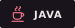](https://dev.java/)
[](https://rust-lang.org/)
[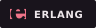](https://www.erlang.org/)

**Systems & Workflow**

[](https://www.kernel.org/)
[](#work--direction)
[](https://docs.docker.com/)
[](https://git-scm.com/docs)

**Security Research**

[](https://cwe.mitre.org/)
[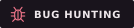](https://portswigger.net/web-security)
[](https://owasp.org/projects/web-security-testing-guide)
[](https://github.com/NationalSecurityAgency/ghidra)
[](https://pwn.college/program-security/)
[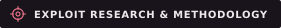](https://pwn.college/software-exploitation/)

**Privacy & Anonymity**

[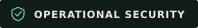](https://ssd.eff.org/)
[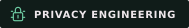](https://www.nist.gov/itl/applied-cybersecurity/privacy-engineering)
[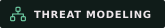](https://community.owasp.org/Threat_Modeling)
[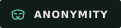](https://www.torproject.org/)

**Human Factors & Intelligence**

[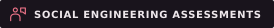](https://www.social-engineer.org/framework/)
[](https://www.bellingcat.com/category/resources/how-tos/)
[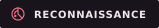](https://nmap.org/book/man-host-discovery.html)

**Tools & Lab**

[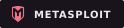](https://www.metasploit.com/)
[](https://portswigger.net/burp)
[](https://www.wireshark.org/)
[](https://www.hackthebox.com/)


## Research & Collaboration

### Cryptography & Wallet Recovery


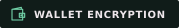

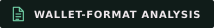


We're looking to connect with **cryptographers, Bitcoin Core developers, and digital-forensics specialists** to investigate difficult wallet-recovery problems, review approaches, and develop reproducible research and tools.

We value clear reasoning, practical contributions, and careful handling of sensitive data.

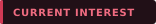 **SS7 vulnerability research and telecom signaling security.**


<a id="building-a-team"></a>
<a id="the-collective"></a>

## Contribute to The Collective

Bring a specialty, explain your approach, and help solve challenging problems together. We welcome researchers and builders with expertise in cryptography, reverse engineering, privacy, vulnerability research, and security tooling.

Our technical practice takes place in designated labs and systems we own or have permission to test. Our wider mission is evidence-led advocacy for human rights and legal reform.

**Entry begins at The Threshold:** complete an assessment, document your reasoning, and submit your work for review when private applications open. Membership is by invitation.

Private tools and OS access are granted separately after acceptance.

**[Enter The Threshold →](threshold/README.md)** · [How review works](threshold/REVIEW.md)

The exercises are available now. Private applications will open when the contact channel below is published. Keep your solutions private in the meantime.

<a id="hack-the-box"></a>

### Hack The Box

**Handle: D3FAULTH.** Hack The Box is part of our practical training. Members can compare approaches, learn together, and support their applications with permitted writeups of retired content.

[Explore Hack The Box](https://www.hackthebox.com/) · **Team URL pending.**

<a id="contact"></a>

### Contact

**Private contact details are being prepared.** The email address and HTB team link will appear here once available. Public applications are not open yet.

Please keep application writeups and personal contact details out of public GitHub Issues. Preparing an exercise does not require your real name or any account credentials.


## GitHub Activity

<p align="center">
  <a href="https://github.com/d3faulth-private">
    
  </a>&nbsp;
  <a href="https://github.com/d3faulth-private">
    
  </a>
</p>
<p align="center">
  <a href="https://github.com/d3faulth-private?tab=repositories">
    
  </a>
</p>


<div align="center">
  
</div>
